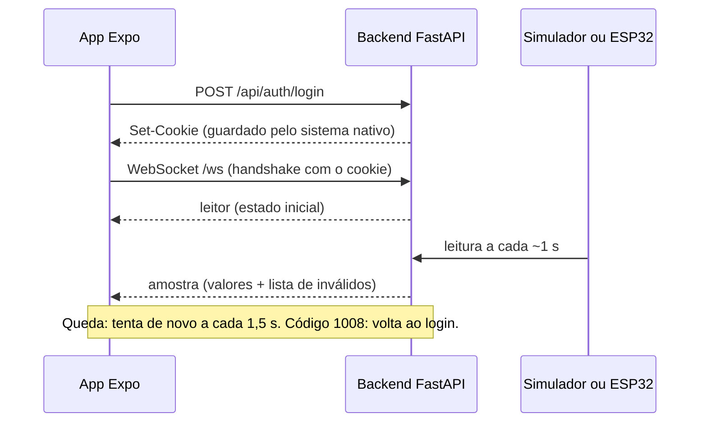

# Diário de pesquisa

## Contexto do TCC

O ODB2 + MS41 Telemetry lê a ECU Siemens MS41 de um BMW E36 por um ESP32-C3 (protocolo DS2, enviado por BLE a um backend FastAPI). Um app desktop React mostra, grava e analisa as sessões.

## Ferramentas de IA usadas

- Claude: pesquisa inicial, primeira versão do código e dos documentos. Por isso o commit inicial aparece com esse autor.
- GitHub Copilot com MCP do Expo: verificação da documentação e ajuste no código.
- ChatGPT e Gemini: comparação do mapa de alternativas.
- Validação feita por mim no aparelho físico, critério por critério.

## Pergunta de pesquisa

Como um app Expo consome o WebSocket autenticado do nosso backend FastAPI para exibir a telemetria ao vivo na rede local, sem mostrar valores inválidos e se recuperando de quedas de conexão?

## Alternativas consideradas

| Opção                                                             | Serve para                                | Expo Go                                        | Decisão                                                                               |
| ----------------------------------------------------------------- | ----------------------------------------- | ---------------------------------------------- | ------------------------------------------------------------------------------------- |
| `WebSocket` do React Native                                       | Receber dados empurrados pelo servidor    | Sim: faz parte do React Native                 | **Sim.** O backend já publica tudo em `/ws`; não exige mudança no servidor            |
| Polling com `fetch` + `@tanstack/react-query` (`refetchInterval`) | Consultar de tempos em tempos             | Sim: JavaScript puro                           | Não. Exigiria criar um endpoint da última amostra e adicionaria o atraso do intervalo |
| SSE com `react-native-sse`                                        | Fluxo do servidor para o cliente por HTTP | A confirmar na documentação                    | Não. O backend não tem endpoint SSE                                                   |
| BLE direto com `react-native-ble-plx`                             | Falar com o ESP32 sem o backend           | Não: exige development build e aparelho físico | Não. Fora das trilhas e perde login e cálculos do backend                             |

## Como funciona

## Fontes oficiais lidas

- Networking, React Native (https://reactnative.dev/docs/network): `WebSocket` é suportado nativamente.
- Código do React Native 0.88.1, `WebSocketModule.kt` (Android) e `RCTWebSocketModule.mm` (iOS): o handshake carrega os cookies do armazenamento compartilhado com o `fetch`.
- Polling, TanStack Query (https://tanstack.com/query/latest/docs/framework/react/guides/polling): `refetchInterval`.
- How to build a Bluetooth Low Energy powered Expo app, Expo (https://expo.dev/blog/how-to-build-a-bluetooth-low-energy-powered-expo-app.md): BLE não roda no Expo Go.

## Onde a IA errou

- Pedido: critérios de aceitação para a prova de conceito (Claude).
- O que veio: um critério dizendo que a "idade" de cada amostra provaria o delay de até 1 s da US01.
- Como percebi: lendo o `TelemetriaProvider.jsx` e o payload real. `t_ms` vem do relógio do ESP32, então o celular só sabe quando a amostra chegou, não quando foi lida.
- O certo: o app mede o intervalo entre chegadas, não o atraso ponta a ponta. O critério foi reescrito, e a US01 continua sem medição completa.

- Pedido: implementar a reconexão automática (Claude).
- O que veio: cada nova tentativa voltava o estado para "conectando".
- Como percebi: teste no aparelho; com o backend caído, a tela não ficava em "Desconectado". O teste automatizado não pegou porque o backend voltou na primeira tentativa.
- O certo: "conectando" só na primeira conexão; depois de cair, fica "Desconectado" até reabrir de fato.

- Pedido: mapa de alternativas para a telemetria ao vivo (ChatGPT).
- O que veio: a sugestão de criar um ticket temporário de conexão, porque o WebSocket do React Native não facilitaria a autenticação.
- Como percebi: teste no aparelho; o cookie do login foi enviado no handshake e o backend aceitou a conexão. O código do React Native 0.88.1 também mostra isso.
- O certo: para o nosso backend, nenhum endpoint novo foi necessário.

## Divergências entre ferramentas de IA

- As duas citaram WebSocket, SSE e MQTT, e indicaram o FastAPI e o Networking do React Native como leitura para WebSocket.
- MQTT: o Gemini o destacou como padrão da indústria IoT/automotiva, com a ressalva do broker extra; o ChatGPT o considerou complexidade desnecessária para um único backend e um app.
- Socket.IO: só o Gemini sugeriu, para ter reconexão automática pronta. O ChatGPT não citou.
- Autenticação do WebSocket: o Gemini sugeriu enviar o token na primeira mensagem ou na URL; o ChatGPT sugeriu um ticket temporário. Nenhuma das duas serve sem mudar o backend, que só aceita cookie ou `Authorization: Bearer` no handshake.
- O que confirmei: a documentação do React Native mostra que o `WebSocket` é suportado, e o nosso backend já publica a telemetria em `/ws`, sem broker. No aparelho, o cookie do login foi enviado no handshake, sem biblioteca extra. A reconexão que o Gemini citou como desvantagem foi implementada em poucas linhas no `lib/telemetria.ts`.

## Resultado e próximos passos no TCC

Testes de bancada, com o cliente de `lib/telemetria.ts` rodando em Node contra o backend real em `--sim` (cookie injetado no teste):

- Login certo, senha errada e servidor fora do ar: tratados.
- Sem cookie: o backend fecha com 1008 e o cliente não fica reconectando.
- Amostras chegaram com intervalo entre 999 e 1003 ms.
- Backend derrubado: detectado em cerca de 100 ms; religado, os dados voltaram sozinhos.

Verificado em aparelho físico: todos os critérios do `CRITERIOS.md` passaram, e o cookie do login foi enviado no handshake do WebSocket sem alterar o backend.

O que muda no TCC: o backend atual já atende um cliente móvel na rede local sem alteração de código, bastando subir com `--host 0.0.0.0`. Para uso fora da rede local, seria preciso hospedar o backend com `wss://`.
